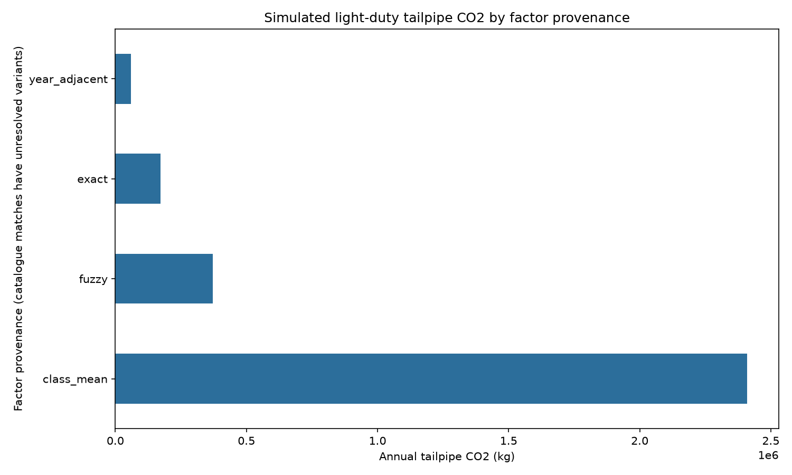
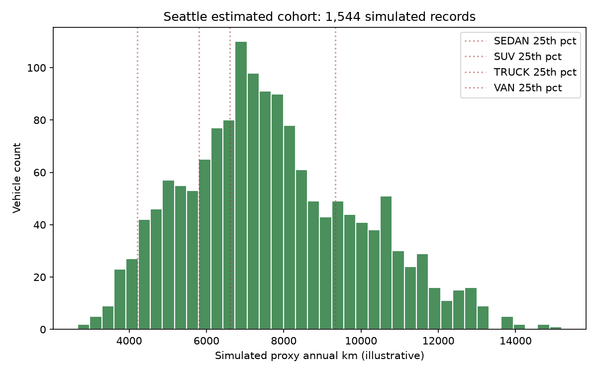
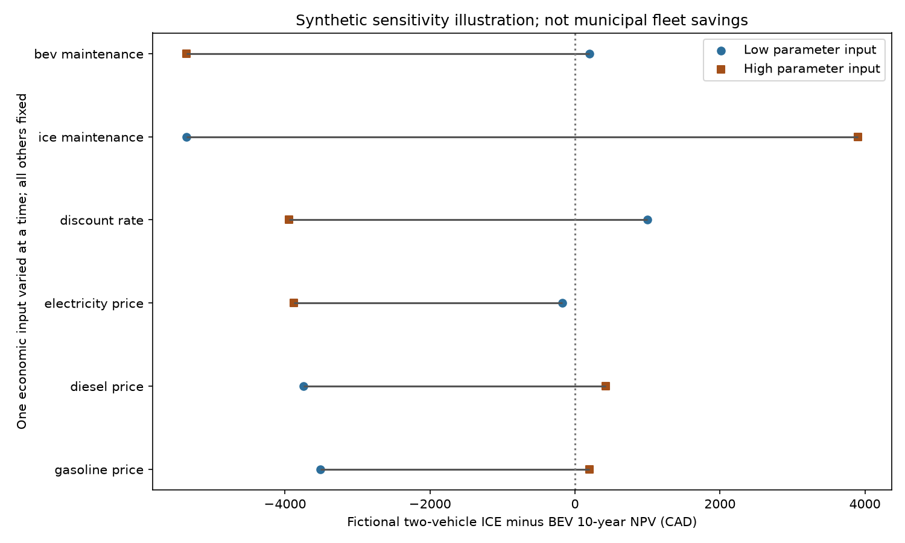

# Results: public-data integration demonstration

Generated from the same results record as `results/results.json` and HTML. This demonstration is not client work.

Analysis year: 2026. Fixed age reference year, not a claim of current inventory or catalogue availability.

## Scope and failed gate

Fleet savings and operational recommendations: **withheld**. Catalogue options are illustrative, awaiting engineering review of payload, body, seating, mission, upfits and current availability. Laval is an ingestion case only.

Stop rules passed: **False**. Stop rule: eligible NRCan match rate 23.02% below 50%

## Seattle simulated light-duty estimate

| Metric | Value |
| --- | ---: |
| Loaded / estimated records | 4,253 / 1,544 |
| Annual fuel (L) | 1,267,587 |
| Annual tailpipe CO2 (t) | 3,012.7 |
| Annual fuel cost (CAD) | 2,104,892 |
| NRCan catalogue match rate (scoped powered light-duty) | 361/1,568 (23.0%) |

Total exclusions: **2,709**. Disjoint breakdown: 602 BEV, 26 non-powered, 511 trailer, 1,570 other unsupported (scope or factor).

Catalogue gate: 361 matches / 1,568 scope/fuel-eligible records. The estimated cohort has 1,544 records; 24 eligible records lack supported factors and are excluded from estimated totals.

NRCan factors are standard test-cycle ratings, not municipal duty-cycle measurements. No measured duty-cycle adjustment is available. Inventory and catalogue vintages differ (ICE ratings 2015-2024); they establish neither current inventory nor current purchase availability. Input hashes identify snapshots, not a common observation year.

## Factor provenance

Catalogue matches use compatible-fuel variant means with unresolved engine and transmission; they are not verified municipal specifications. Class proxies use arithmetic means and observed catalogue extrema, not medians. Known weights and identified duty tokens screened; specialization remains unresolved. SERVICE BODY and CUTAWAY can pass; scope/upfit statuses in both ledgers disclose this. Generic factors are unsupported and contribute no estimate. Excluded records are not zero-emission assets.

| Provenance | Records | CO2 (t) | Share of estimate |
| --- | ---: | ---: | ---: |
| class_mean | 1183 | 2,409.0 | 80.0% |
| exact | 108 | 173.0 | 5.7% |
| fuzzy | 215 | 371.4 | 12.3% |
| generic | 15 | 0.0 | 0.0% |
| not_applicable | 2694 | 0.0 | 0.0% |
| year_adjacent | 38 | 59.3 | 2.0% |

## Uncertainty and descriptive flags

Conditional row-bootstrap diagnostic (central 95% of resamples): 2,951.5 to 3,071.8 t. The estimand is the sum of n iid draws from the empirical distribution of fixed simulated light-duty emissions. It has no coverage claim for the real finite municipal fleet. Calibration, classification and mission errors are omitted.

Assumption range (t): 1,470.0 to 5,539.4. Chosen mileage multipliers 0.7/1.3 times observed variant/class factor extrema. This is not a probability interval.

NYC threshold overlap: 76.4%; quartile versus median labels on the same groups, not accuracy. Composite versus g/km rho: -0.208 (row diagnostic -0.402 to -0.022), not superiority.

All three diagnostics and the utilization chart use the same estimated cohort of 1,544 records, including light-duty trucks. Quartiles are recalculated within this cohort; excluded records are not flagged. Age-only flags: 304; kilometre-only Toronto proxy flags: 181; simulated quartile flags: 387. These flags do not establish surplus. Legacy zero fleet scenario values are withheld placeholders; not evaluated fleet outcomes. Engine hours, frequency, dispatch, reserve, emergency coverage and service demand are absent. No ranked replacement or reallocation plan is released.

## Fictional cost example

Two equivalent hypothetical base vehicles each travel 12,000 km/year; one uses 960 L gasoline and one 1,080 L diesel. Both BEVs use 20 kWh/100 km. Capital is CAD 35,000 ICE versus CAD 45,000 BEV plus CAD 3,500 charging per unit. No historical in-service value, FX conversion, specialist upfit, tax or residual value enters this illustration. All mileage transfers to BEVs: 100% vehicle tailpipe reduction, with upstream/manufacturing excluded. This is not fleet savings.

Fictional cash flows (CAD): ICE NPV: 106,091.39; BEV NPV: 107,748.66; ICE minus BEV NPV: -1,657.27. Six one-at-a-time economic ranges are in `results/sensitivity.csv`; emissions are physically invariant to these prices. Scenario confidence intervals are withheld.

## Canadian aggregate accounting example

Federal source GHG is CO2e. Latest-year scope-1 on-road gasoline and diesel are compared separately to illustrative 2.3/2.7 kg CO2/L references. Differences can reflect rounding, blends and non-CO2 gases; this does not validate Seattle factors.

Status: ok; fiscal year beginning 2024; compatible rows 42 of 129.

| Fuel | Litres | kg CO2e/L | Illustrative CO2 kg/L |
| --- | ---: | ---: | ---: |
| diesel | 6,543,997 | 2.739 | 2.7 |
| gasoline | 12,869,366 | 2.309 | 2.3 |

## Ingestion reconciliation

Loaded means accepted by the source parser, before analysis exclusions. Seattle publisher_footer rows are Total and Applied filters metadata, not vehicles. Laval blank_year rows are rejected inventory records; Laval remains ingestion only. The small rejected-record ledger is results/ingestion_rejections.csv; source_row is a 1-based data-record ordinal after the header.

| Source | Raw | Loaded | Rejected | Reasons |
| --- | ---: | ---: | ---: | --- |
| seattle_fleet | 4,255 | 4,253 | 2 | publisher_footer: 2 |
| laval_fleet | 1,318 | 1,232 | 86 | blank_year: 86 |
| nyc_efficiency | 106 | 106 | 0 | none |
| nrcan_ratings | 10,060 | 10,060 | 0 | none |
| nrcan_bev | 1,250 | 1,250 | 0 | none |
| federal_fleet_fuel | 1,666 | 1,666 | 0 | none |

## Input receipt

Hashes identify observed publication inputs; retrieval timestamps for inherited caches are unknown. Changed endpoints fail the pinned release check; update inputs explicitly and reassess outputs. Snapshot availability is not guaranteed.

| Dataset | Rows | Bytes | SHA-256 | Observed UTC |
| --- | ---: | ---: | --- | --- |
| seattle_fleet | 4255 | 493225 | aa210650a96b36c2ca2cb905742a640244ce4078e37d4194c34ddc4c26dc5b53 | 2026-10-12T20:31:37.395094+00:00 |
| nyc_efficiency | 106 | 13489 | 1262a9b3d646ffd7ef88e69b7afeb069bd2784caf0339390215a0853015df1ef | 2026-10-12T20:31:37.395094+00:00 |
| laval_fleet | 1318 | 167160 | b22b7cc0cb188d3a778416e365ac9969ddbbef9bfdcd01e5a93725d95af17d6c | 2026-10-12T20:31:37.395094+00:00 |
| nrcan_ratings | 10060 | 827253 | adb157dccde5d954d34b8a068f9dd604ad28b0050d2bb3ba17d26678761d2cb7 | 2026-10-12T20:31:37.395094+00:00 |
| nrcan_bev | 1250 | 138739 | d37f52ee8049e93b37f66ac233b037e6abe0218ef3635ef6cbddf8fb8c675f51 | 2026-10-12T20:31:37.395094+00:00 |
| federal_fleet_fuel | 1666 | 205795 | ab20d5905523fb18ffcdc29e4af747267b46040bf8eab82c89429f4877ef5fa8 | 2026-10-12T20:31:37.395094+00:00 |

## Performance receipt

OS/architecture: macOS-27.0.1-arm64-arm-64bit; Python: 3.11.15. Process high-water RSS: 193.6 MiB. Instrumented stage sum: 10.09 s. Through CSV/HTML output: 10.22 s. Imports, final JSON/Markdown metadata serialization and interpreter startup are excluded. Stage RSS observations are process high-water marks, not isolated usage.

## Charts

This code-generated chart uses only the synthetic two-vehicle cost inputs described above. Each of six economic inputs varies alone; all others stay fixed. Numeric low/high inputs and NPV values are in `results/sensitivity.csv`.

Portable HTML embeds its images and provider notices. See `ATTRIBUTION.md` for data attribution; portable outputs carry `results/ATTRIBUTION.md`. Code is Apache-2.0; prose is CC BY 4.0; source rights continue to apply to figures and derived data.
